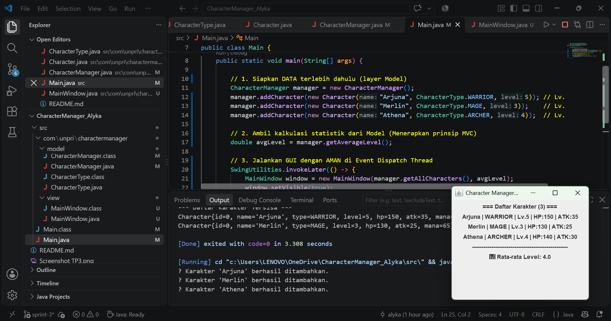
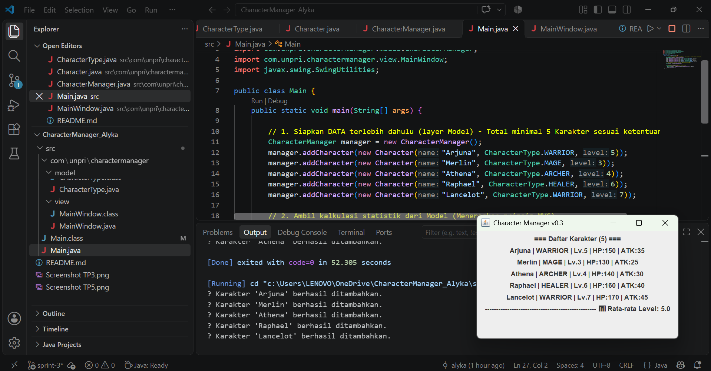

## TP8 — MainWindow, Data Dinamis & Analisis MVC

### Screenshot Aplikasi
**1. Kondisi Awal (5 Karakter)**

**2. Setelah Penambahan Data (6 Karakter — Statistik Berubah)**

### Aliran Data & Prinsip MVC
Aliran data dimulai dari `Main.java` (berperan sebagai Controller/inisialisasi) yang membuat objek-objek `Character` dan menyimpannya ke dalam `CharacterManager` (layer **Model**). Selanjutnya, `CharacterManager` mengelola koleksi data tersebut serta menghitung statistik `getAverageLevel()` secara internal tanpa campur tangan tampilan. Data salinan daftar karakter (`getAllCharacters()`) dan nilai rata-rata level kemudian dikirimkan melalui parameter konstruktor menuju `MainWindow` (layer **View**). `MainWindow` hanya bertugas merender data yang diterima ke dalam komponen `JLabel` secara dinamis menggunakan perulangan, sehingga pemisahan tugas (Separation of Concerns) dalam arsitektur MVC tetap terjaga.

### Daftar Karakter Baru & Alasan Pemilihan
1. **Raphael (`HEALER`, Level 6):** Ditambahkan untuk melengkapi komposisi tim yang sebelumnya belum memiliki peran penyembuh (*support*), dengan level 6 agar memiliki kapasitas HP dasar yang cukup tinggi (`160 HP`) untuk bertahan di garis belakang.
2. **Lancelot (`WARRIOR`, Level 7):** Ditambahkan sebagai petarung garis depan kedua dengan level tertinggi (`7`) guna menguji perubahan nilai rata-rata statistik secara signifikan serta memvalidasi perhitungan HP (`170`) dan ATK (`45`).

### Dokumentasi Analisis (Bagian D)
-Link Google Docs Analisis GUI & MVC : https://docs.google.com/document/d/1XonWHd4YzvKCWsVufNltKQTQ8frGako4CmX2f0v2QcA/edit?usp=sharing