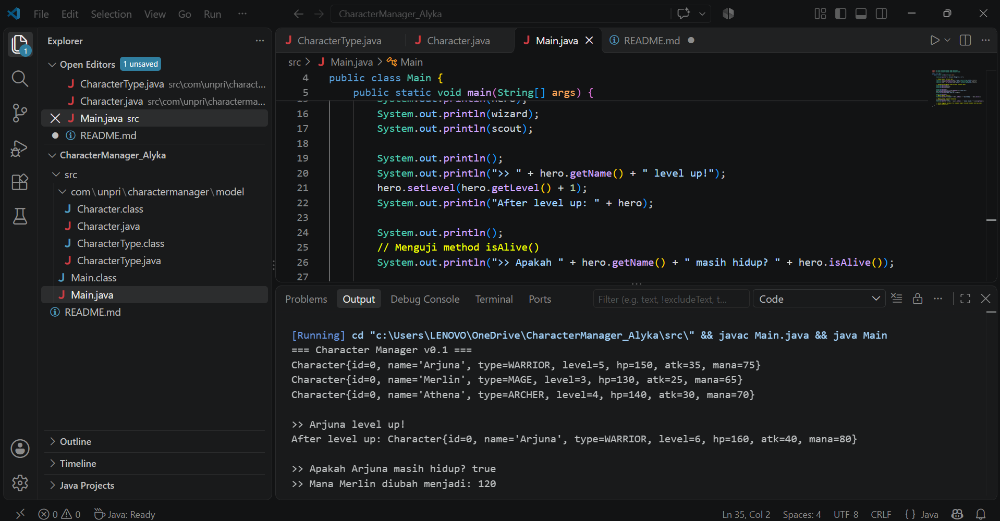

# Character Manager — TP3 (Java Visual SIH-6406)

Aplikasi konsol berbasis Java yang mengimplementasikan fondasi *model layer* untuk sistem manajemen karakter RPG menggunakan prinsip pemrograman berorientasi objek (*Encapsulation*, *Type-Safe Enum*, dan *Constructor Overloading*). Proyek ini dilengkapi validasi atribut (`level` dan `mana`), perhitungan statistik otomatis, serta pengecekan status hidup karakter (`isAlive()`).

## Screenshot Output Terminal



## Struktur Folder Project

```text
javavisual-tp03-[NIM]/
├── README.md
├── screenshots/
│   └── output.png
└── CharacterManager/
    └── src/
        ├── Main.java
        └── com/
            └── unpri/
                └── charactermanager/
                    └── model/
                        ├── Character.java
                        └── CharacterType.java

Nama    : Alyka Shakira Lubis
Nim     : (253303621239)
Kelas   : Semester 3 Pagi A
Link Google Docs : https://docs.google.com/document/d/1NfQNNXsIrucDt7KqxUM5YLN8f7SzGLRA_5qK-nVlh0g/edit?usp=sharing
