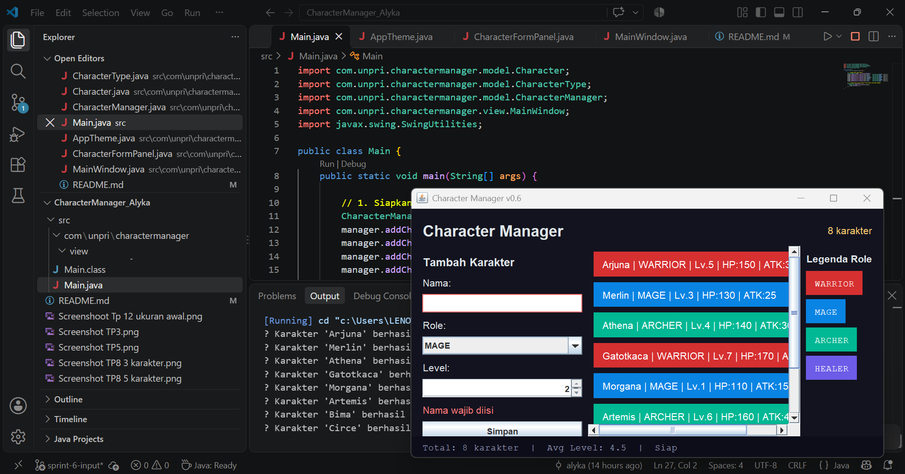
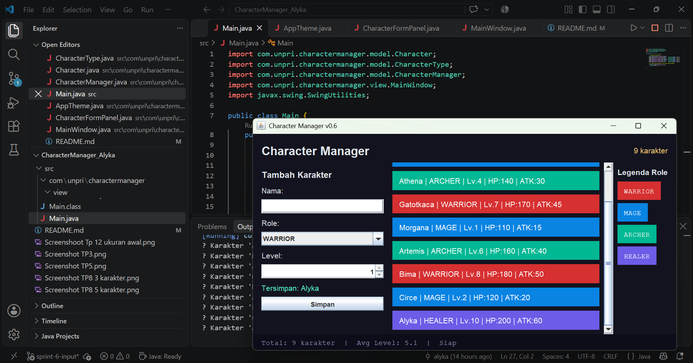

## TP14 — Sprint #6: Form Input, Validasi & Analisis MVC

### 1. Screenshot Pengujian
1. **Validasi Error (Nama Kosong):**
   
2. **Validasi Keunikan (Nama Duplikat):**
   
3. **Input Valid (Kartu Baru Berhasil Ditambahkan):**
   

---

### 2. Matriks Uji Input (10 Kasus Uji)

| No | Input (Nama, Role, Level) | Hasil Diharapkan | Hasil Nyata | Lapisan yang Menangkap |
| :--- | :--- | :--- | :--- | :--- |
| 1 | Nama: `""` (kosong), Role: `WARRIOR`, Level: `1` | Muncul pesan merah `"Nama wajib diisi"`, border `nameField` merah, kursor fokus ke `nameField`. | Sesuai harapan. Form menolak simpan dan border merah aktif. | **View** (`CharacterFormPanel.validateName`) |
| 2 | Nama: `"   "` (hanya spasi), Role: `WARRIOR`, Level: `1` | Dianggap kosong setelah `trim()`, pesan `"Nama wajib diisi"`, border merah. | Sesuai harapan. Spasi dibersihkan oleh `trim()` lalu ditolak. | **View** (`CharacterFormPanel.onSave` & `validateName`) |
| 3 | Nama: `"Ab"`, Role: `ARCHER`, Level: `5` | Muncul pesan `"Nama harus 3-20 karakter"`, border `nameField` merah. | Sesuai harapan. Gagal pada validasi panjang karakter. | **View** (`CharacterFormPanel.validateName`) |
| 4 | Nama: `"Arjuna123"`, Role: `WARRIOR`, Level: `10` | Muncul pesan `"Nama hanya huruf dan spasi"`, border `nameField` merah. | Sesuai harapan. Regex `[A-Za-z ]+` menolak angka. | **View** (`CharacterFormPanel.validateName`) |
| 5 | Nama: `"arjuna"` (huruf kecil), Role: `MAGE`, Level: `5` | Muncul pesan `"Nama sudah dipakai"`, karena `"Arjuna"` sudah terdaftar. | Sesuai harapan. `equalsIgnoreCase` mendeteksi duplikasi. | **Model via View** (`CharacterManager.isNameTaken`) |
| 6 | Nama: `"  Bima Sakti  "`, Role: `ARCHER`, Level: `12` | Tersimpan sebagai `"Bima Sakti"`, kartu hijau muncul, pesan hijau `"Tersimpan: Bima Sakti"`, form ter-reset. | Sesuai harapan. Spasi tepi dibuang dan daftar langsung ter-refresh. | **Sukses** (Lolos View & Model) |
| 7 | Nama: `"Gandalf"`, Role: `MAGE`, Level: `65` *(Mini-Challenge)* | Muncul pesan merah `"Level MAGE maksimal adalah 60"`, border `levelSpinner` merah. | Sesuai harapan. Pesan dari Model tampil langsung di View tanpa mengubah kode View. | **Model** (`Character` constructor) |
| 8 | Nama: `"Rafael"`, Role: `HEALER`, Level: `2` *(Validasi Tambahan 1)* | Muncul pesan merah `"Level HEALER minimal adalah 5"`, border `levelSpinner` merah. | Sesuai harapan. Aturan domain `HEALER` terjaga di Model. | **Model** (`Character` constructor) |
| 9 | Nama: `"Ksatria"`, Role: `WARRIOR`, Level: `500` (diketik manual di spinner) | Spinner menolak nilai di luar rentang `1-99` saat `commitEdit()` dan mengembalikannya ke nilai valid sebelumnya (`1`). | Sesuai harapan. Tidak ada karakter berlevel > 99 yang bisa masuk. | **Komponen UI** (`SpinnerNumberModel`) & **Model** (`Character`) |
| 10 | Menambah karakter ke-21 saat daftar sudah berisi 20 karakter *(Validasi Tambahan 2)* | Muncul pesan merah `"Kapasitas penuh: maksimal 20 karakter"`, karakter ke-21 ditolak. | Sesuai harapan. Kapasitas list terjaga di `CharacterManager`. | **Model** (`CharacterManager.addCharacter`) |

#### Catatan Pengujian & Penjelasan Lokasi Validasi Tambahan
* **Perilaku Spinner (`Level: 500`):** Saat angka `500` diketik langsung pada `JSpinner` lalu tombol **Simpan** ditekan, `levelSpinner.commitEdit()` mendeteksi bahwa nilai tersebut melampaui batas maksimum `SpinnerNumberModel` (`99`) sehingga melempar `ParseException` atau mengembalikan nilai ke nilai sah terakhir, memastikan lapisan Model tidak pernah menerima level tidak valid.
* **Alasan Lokasi Validasi Tambahan 1 (`HEALER` minimal level 5 $\rightarrow$ Model `Character`):** Aturan ini merupakan aturan bisnis/domain yang melekat pada entitas `Character` itu sendiri. Dengan meletakkannya di konstruktor `Character`, aturan ini tetap berlaku meskipun objek dibuat lewat konsol, database, atau file JSON tanpa melewati form GUI.
* **Alasan Lokasi Validasi Tambahan 2 (Maksimal 20 karakter $\rightarrow$ Model `CharacterManager`):** Aturan kapasitas daftar berkaitan dengan pengelolaan koleksi objek secara keseluruhan, yang merupakan tanggung jawab tunggal `CharacterManager`, bukan tugas tampilan (`View`).

---

### 3. Penjelasan Kompromi Sementara (Arsitektur)
Pada Sprint #6 ini terdapat dua kompromi arsitektur yang disengaja agar fokus tetap pada mekanisme input dan validasi:
1. **Penggunaan `ActionListener` minimal (lambda satu baris):** Penanganan klik tombol Simpan dan tekan Enter pada `nameField` masih ditulis langsung menggunakan lambda singkat (`e -> onSave()`) di dalam panel View, dan belum dipisahkan ke kelas *listener* khusus.
2. **Pemanggilan `manager.addCharacter()` langsung dari View:** `CharacterFormPanel` berinteraksi langsung dengan objek Model (`CharacterManager`) untuk menyimpan data. Pada Pertemuan 9 mendatang, alur ini akan dirapikan dengan memindahkan logika koordinasi dan *event handling* tersebut ke lapisan **Controller** agar pemisahan tanggung jawab MVC (Model-View-Controller) menjadi sepenuhnya bersih.

---

### 4. Link Dokumen Analisis (Bagian D)
* **Google Docs Analisis Input & Validasi:** (https://docs.google.com/document/d/1WGKQfxigMUt2IgjX7vGvnNjOF1VeYrsLyyptOGd7ff4/edit?usp=sharing)
*